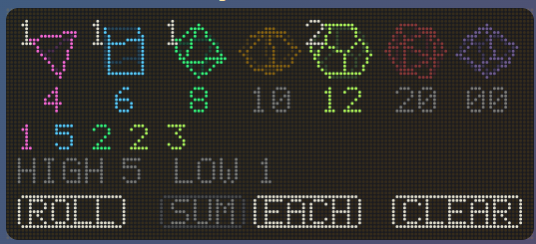
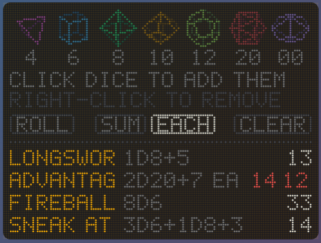
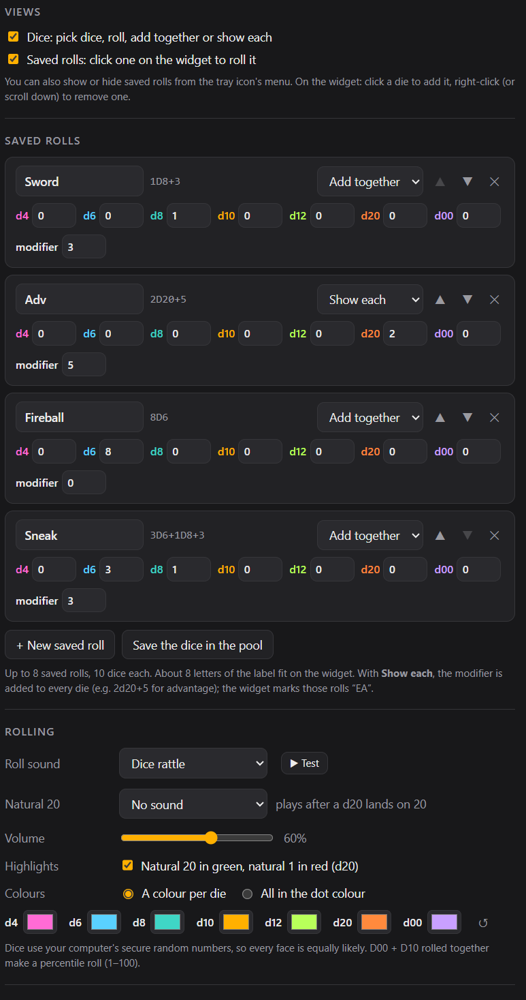

# Dot Dice

A dot-matrix dice roller for D&D and other tabletop games, for Windows and macOS.

## What it does

It has two views. Show either one, or both stacked:

**Dice**
- **The dice:** d4, d6, d8, d10, d12, d20 and d00, drawn as slowly spinning dot-matrix shapes with no numbers on them.
- **Picking dice:** click a die to add one, up to 10 dice in any mix. Right-click it, or scroll down over it, to remove one. Dice you've picked light up, spin a little faster, and show how many are in the pool.
- **ROLL:** the numbers flicker for a moment and then land, with a quick spin and an optional dice-rattle sound.
- **SUM / EACH:**
  - **SUM** adds everything up, with the breakdown beside the total.
  - **EACH** shows every result in its die's colour, plus the highest and lowest, which is handy for advantage, disadvantage or "pick the highest".
  - You can switch after rolling.
- **d00 + d10** rolled together make a percentile roll (1–100).

**Saved rolls**
- **Rolling:** click a saved roll on the widget to roll it. The result appears at the end of its row.
- **Each saved roll** has:
  - a label
  - its dice
  - a flat modifier (−99 to +99)
  - **Add together** (one total, modifier added once) or **Show each** (the modifier added to every die, for example 2d20+5 for advantage)
- **Managing them:** add, edit, reorder and remove them in settings, or save the dice you've picked on the widget in one click. Up to 8.

**Settings also include:**
- **Crits:** a natural 20 shows in green and a natural 1 in red (d20), and can be turned off. There's an optional chime for natural 20s.
- **Sounds:** a dice rattle or any of the family's ten chimes, with a volume slider.
- **Colours:** one per die, or everything in the dot colour.
- **Matching Dot Clock:** same width, dot size and colours.

Rolls use your computer's secure random number source, so every face is equally likely. Dot Dice works fully offline.

## Where it lives

The widget doesn't take up a spot on the taskbar (or the Dock on a Mac). It sits in the **system tray** (the menu bar on a Mac) instead. Left-click the tray icon to bring the widget forward, and right-click it to show or hide the widget or the saved rolls, open settings, move the widget to the centre of the screen, or quit.

## Building it yourself

See [BUILDING.md](BUILDING.md). The installer is called `Dot Dice_1.0.0_x64_en-US.msi`.

## Check out the Singular Widgets

[Dot Calendar](https://github.com/slainbya-dotcom/dot-Calendar)
[Dot Clipboard](https://github.com/slainbya-dotcom/dot-clipboard)
[Dot Clock](https://github.com/slainbya-dotcom/dot-clock)
[Dot Deck](https://github.com/slainbya-dotcom/dot-deck)
[Dot Dice](https://github.com/slainbya-dotcom/dot-dice)
[Dot Focus](https://github.com/slainbya-dotcom/dot-focus)
[Dot Launcher](https://github.com/slainbya-dotcom/dot-launcher)
[Dot List](https://github.com/slainbya-dotcom/dot-list)
[Dot Planner](https://github.com/slainbya-dotcom/dot-planner)
[Dot Player](https://github.com/slainbya-dotcom/dot-player)
[Dot Reader](https://github.com/slainbya-dotcom/dot-reader)
[Dot Sun](https://github.com/slainbya-dotcom/dot-sun)
[Dot System](https://github.com/slainbya-dotcom/dot-system)
[Dot Ticker](https://github.com/slainbya-dotcom/dot-ticker)
[Dot Timer](https://github.com/slainbya-dotcom/dot-timer)
[Dot Visualiser](https://github.com/slainbya-dotcom/dot-visualiser)
[Dot Weather](https://github.com/slainbya-dotcom/dot-weather)